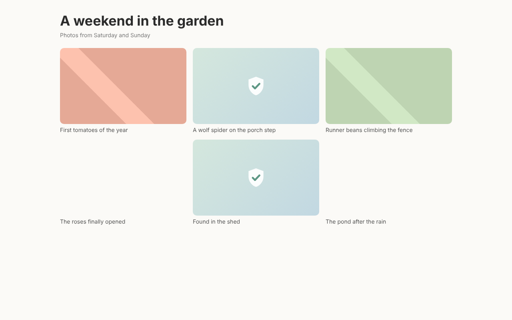
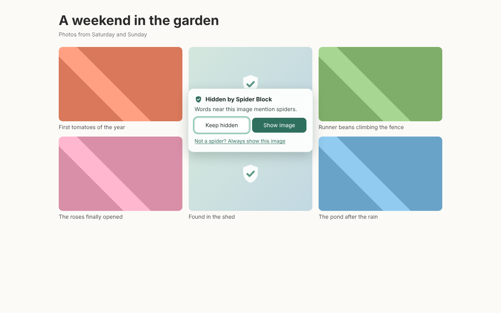
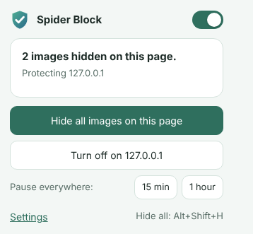

# Spider Block

A browser extension for people with arachnophobia. It hides pictures of spiders as you browse, the way an ad blocker hides ads, so you can use the web without the scare.

It works in **Firefox, Chrome, Edge and Safari** from one codebase, and it runs **entirely on your device**: no account, no tracking, and images are never uploaded anywhere.

> This README and the extension's own pages contain no spider pictures. The screenshots below use plain colour blocks in place of photos.

| A page with two spider photos hidden | Clicking a hidden image | Toolbar popup |
| --- | --- | --- |
|  |  |  |

## What it does

- **Finds spiders three ways**
  - **Words around a picture.** Alt text, captions, file names, link addresses and the title of the card or video tile it sits in, in more than 40 languages. It knows that Spider-Man, spider plants, a Fiat 124 Spider and a web-crawler "spider" are not spiders, and that Marvel's Black Widow is not the arachnid.
  - **The picture itself.** A small image-recognition model (MobileNet v2) runs inside the extension and recognises spiders, including tarantulas, black widows, wolf spiders, garden spiders and daddy longlegs. For larger photos it also looks closely at the corners, to catch small spiders.
  - **Pages about spiders.** On a search for spiders or an article about them, every image on the page is hidden.
- **Holds images back until they've been checked**, so you don't catch a glimpse first. Images near the screen are checked first.
- **Your choice of how hidden images look:** a soft cover with a shield, a calming picture (hills, sea, a night sky…), blank space, or a heavy blur.
- **Asks before showing anything.** Clicking a hidden image opens a small panel. You can require a press-and-hold to show it, or turn showing off entirely.
- **Hide everything at once** with <kbd>Alt</kbd>+<kbd>Shift</kbd>+<kbd>H</kbd> (or the right-click menu) when you need a break. Press it again to undo.
- **Corrections.** Right-click → *Hide this image* if one slips through, or *This isn't a spider* if something harmless was hidden. Spider Block remembers your choices.
- **Per-site off switch, pause for 15 minutes or an hour,** and a count of hidden images on the toolbar icon.
- **Optional extras:** hide spider webs, hide scorpions, ticks and mites, cover the word "spider" in page text, add your own words to hide or allow.
- Handles lazy-loading, infinite scroll, single-page apps, CSS background images, `<picture>`/`srcset`, video posters, iframes and shadow DOM.

No filter is perfect. Spider Block is a strong safety net, not a guarantee. See [Limitations](#limitations).

## Install it for yourself (from source)

You need [Node.js](https://nodejs.org/) 20 or newer.

```sh
npm install
npm run build          # builds dist/chrome, dist/edge, dist/firefox, dist/safari (+ zips)
```

**Firefox**: open `about:debugging#/runtime/this-firefox` → *Load Temporary Add-on…* → choose `dist/firefox/manifest.json`. Temporary add-ons are removed when Firefox restarts. To keep it installed, sign it for yourself: submit the zip to [addons.mozilla.org](https://addons.mozilla.org/developers/) as an *unlisted* add-on (free, usually approved automatically within minutes) and install the signed `.xpi` it gives you. Needs Firefox 140 or newer.

**Chrome / Edge / Brave**: open `chrome://extensions` (or `edge://extensions`), turn on *Developer mode*, click *Load unpacked* and choose `dist/chrome` (or `dist/edge`).

**Safari** (needs a Mac with Xcode):

```sh
xcrun safari-web-extension-converter dist/safari --app-name "Spider Block" --bundle-identifier com.example.spiderblock
```

Open the generated Xcode project, run it, then enable the extension in Safari → Settings → Extensions and allow it on all websites. For local testing without signing, turn on *Allow unsigned extensions* in Safari's Developer settings. The same project can target iPhone and iPad.

## Sharing it with others

Publishing to the official stores lets people install it with one click and get automatic updates. [docs/store-listing.md](docs/store-listing.md) has ready-to-paste descriptions, the permission justifications reviewers ask for, and the privacy answers.

| Store | Cost | Upload | Notes |
| --- | --- | --- | --- |
| [Firefox Add-ons](https://addons.mozilla.org/developers/) | Free | `dist/spider-block-firefox-*.zip` | Reviewers may ask for the source: upload a zip of this repo; it builds with `npm ci && npm run build:firefox`. Change the add-on ID in `scripts/build.mjs` first if you want your own. |
| [Chrome Web Store](https://chrome.google.com/webstore/devconsole) | $5 once | `dist/spider-block-chrome-*.zip` | Needs the privacy policy URL (you can link to [PRIVACY.md](PRIVACY.md) on GitHub). |
| [Edge Add-ons](https://partner.microsoft.com/dashboard/microsoftedge/) | Free | `dist/spider-block-edge-*.zip` | |
| Safari / App Store | $99/year Apple Developer Program | Xcode project (see above) | Submitted as a Mac (and optionally iOS) app through App Store Connect. |

Bump `version` in `package.json` before each new upload.

## How it works

```
page loads ─► content script (every page and frame)
               │  hides images until checked (CSS injected before the page renders)
               │  1. your corrections        → hide / show
               │  2. words near the image    → hide
               │  3. page about spiders?     → hide
               │  4. ask the background ─────────► background script
               │                                   downloads the image (from the browser cache when possible)
               │                                   MobileNet v2 via TensorFlow.js (WebAssembly)
               │  ◄──────── spider scores ─────────┘ (cached)
               ▼
           shows the image, or covers it in your chosen style
```

- **Content script** (`src/content/`): watches the page with a `MutationObserver`, marks each image with `data-sb="pending|ok|blocked|revealed"`, and `content.css` styles those states. Hidden images keep their size and the page layout does not change: the picture is moved out of the image's box with `object-position` and the cover is drawn as its background.
- **Word matching** (`src/shared/terms.js`): term lists for spiders, webs and other arachnids in many languages, with allow-lists for things like Spider-Man. Optimised so long pages in languages without spaces stay fast.
- **Image recognition** (`src/background/`): the background script downloads the image again (the extension's host permission lets it read any image), draws it at 224×224 and runs [MobileNet v2](https://github.com/tensorflow/tfjs-models/tree/master/mobilenet) with [TensorFlow.js](https://www.tensorflow.org/js) on WebAssembly. The spider classes' probabilities are summed and compared with the sensitivity threshold. On the *Balanced* setting the corners of a photo are only examined when the first look finds a hint of a spider. On ImageNet samples this skips 98% of ordinary photos without missing a spider. Each image takes roughly 30–100 ms on a typical computer.
- The model is the standard ImageNet MobileNet v2, stored as float16 (7 MB). `scripts/fetch-model.mjs` downloads it from Google, checks it against pinned checksums and converts it, so the bundled file can be reproduced.

## Developing

```sh
npm run build            # all browsers (or build:chrome, build:firefox, …)
npm test                 # unit tests (word matching, settings)
npm run test:e2e         # loads dist/chrome into Chromium and tests real pages
npm run test:firefox     # the same for dist/firefox in Firefox (set FIREFOX_BIN if it isn't found)
npm run lint             # Mozilla's add-on linter on the Firefox build
npm run test:ai          # opt-in: checks recognition with real photos (see warning below)
npm run icons            # re-render the PNG icons from src/images/icon*.svg
node scripts/screenshots.mjs   # re-take docs/screenshots (spider-free demo page)
```

The end-to-end tests use only generated colour blocks: the "spiders" in them are words in alt text, captions and file names.

To check an installed copy by hand, open [`test/manual/safe-test.html`](test/manual/safe-test.html) in the browser. It contains no spider pictures and shows a live checklist of what the extension hid. In Chrome or Edge, first turn on *Allow access to file URLs* in the extension's Details page. Firefox never runs extensions on files opened from disk, so in Firefox open the page from a web address (for example GitHub Pages, or `npx http-server test/manual`).

> **Warning:** `npm run test:ai` downloads real spider photos into `test/.spider-photos/` (git-ignored, neutral file names) to check the image recognition end to end. Nothing is displayed, but avoid opening that folder.

```
src/             (manifest.json is generated per browser by scripts/build.mjs)
  shared/        browser API shim, settings, spider word lists + matcher
  content/       content script and page CSS (images inlined at build time)
  background/    classifier, image loader, messaging, menus, badge
  popup/ options/ welcome/ ui/   extension pages
  images/        icons, cover shield, calming scenes (all spider-free)
  model/         MobileNet v2 (float16)
scripts/         build, model download, icon rendering, screenshots
test/            unit, end-to-end and opt-in AI tests
```

## Privacy

Spider Block does not collect, store or send any personal data, and has no servers. Settings and your corrections stay in your browser (settings sync between your devices only if your browser syncs extension settings). To check an image, the extension downloads that image again, which is the same request your browser already made to show it. See [PRIVACY.md](PRIVACY.md).

## Limitations

- **Drawings, cartoons, emoji and unusual photos** are recognised less reliably than ordinary photos. The model learned from photos. Words around the image still help.
- **Videos**: Spider Block checks a video's title, poster image and surrounding text, but not the moving picture itself.
- Images drawn on a `<canvas>`, inside closed shadow DOM, or in browser-internal pages can't be checked.
- When the browser starts, the first images take a moment longer while the model loads.
- Some sites refuse to send their images to extensions. You choose whether those are shown or kept covered.
- **Tested**: Chrome/Chromium and Firefox desktop (automated end-to-end tests, Firefox 140 ESR and newer). **Firefox for Android** is not supported yet: it has no right-click menu, so a missed spider can't be hidden. **Safari** builds have not been tested. Please report problems.

## Ideas for the future

- **Firefox for Android**: a touch-friendly way to hide an image that slipped through (phones have no right-click menu), then tested on a phone and enabled with `gecko_android`.
- **Watch videos too**: sample frames of playing videos (YouTube etc.) and pause and cover the video when a spider appears.
- **A spider-specific model**: fine-tune a small model on spiders vs. look-alikes, including drawings and cartoons, and use the GPU (WebGPU) where available.
- **Shared corrections (opt-in)**: let users anonymously share image fingerprints they've hidden, so a miss found by one person protects everyone.
- **Lock settings with a PIN**, for parents or carers setting it up for someone else.
- **Other phobias**: the same engine could hide snakes, insects, needles or holes (trypophobia). ImageNet already covers several of these.
- **Gentle exposure mode** (opt-in, ideally designed with therapists): gradually reveal blurred or cartoon versions for people working on their fear.
- **Translations** of the extension's pages.

## License

MIT, see [LICENSE](LICENSE). TensorFlow.js and the MobileNet v2 model are Apache-2.0, see [THIRD_PARTY_NOTICES.md](THIRD_PARTY_NOTICES.md).
